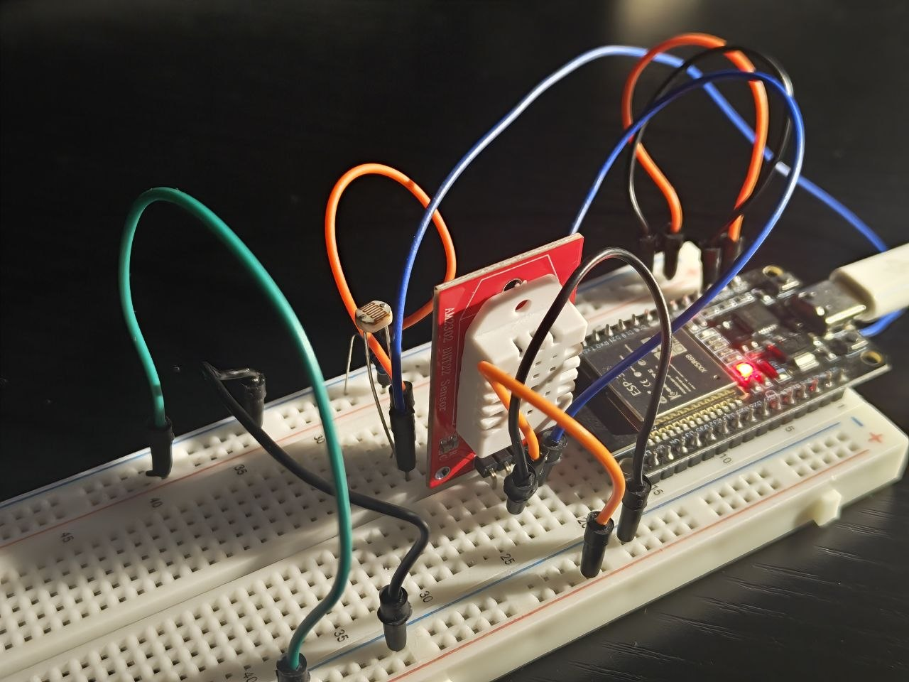
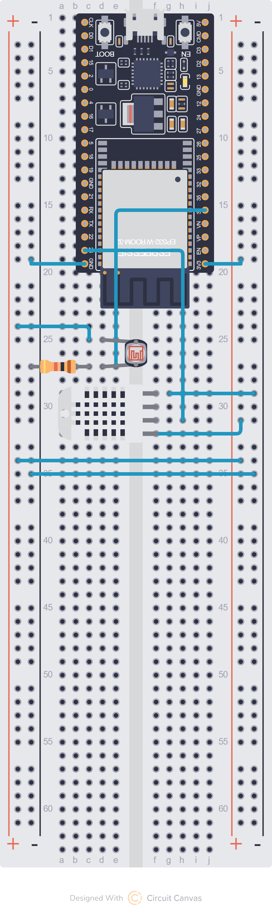

# Smart Windowsill 🌱

An intelligent plant microclimate monitoring system powered by an **ESP32** hardware station, a modern **Android (Jetpack Compose)** app with **Claude AI** for automated plant care and species identification, and a **Node.js / Express** backend API.

---

## 📸 Device & Wiring Diagram

### Hardware Setup


### Circuit Schematic


---

## 🛠 Project Architecture

The repository is structured into three main modules:

```
SmartWindow/
├── esp_PlatformIO/                 # ESP32 firmware (PlatformIO / C++)
├── SmartWindowsill_AndroidStudio/  # Android mobile app (Kotlin, Jetpack Compose, Room)
├── plant-api/                      # REST API for plant database (Node.js, Express, MongoDB)
├── circuit.png                     # Circuit schematic diagram
├── circut.png                      # Reference link to schematic
├── esp.png                         # Assembled hardware device photo
└── README.md                       # Project documentation
```

---

## 🔌 1. Hardware Station (`esp_PlatformIO`)

The **ESP32 DevKit** board samples ambient environmental sensors and transmits real-time telemetry over **Bluetooth Low Energy (BLE)** to the connected Android smartphone.

### Connected Sensors & Pinout:
| Sensor | Measured Parameter | ESP32 Pin | Details |
|---|---|---|---|
| **DHT22** (AM2302) | Temperature (°C), Relative Humidity (%) | `GPIO 23` | Digital temperature/humidity sensor |
| **Photoresistor (LDR)** | Ambient Light (Lux / ADC) | `GPIO 34` | Analog input (ADC1) with voltage divider |

### BLE Service:
- **Device Name**: `ESP32_SENSOR`
- **Service UUID**: `4fafc201-1fb5-459e-8fcc-c5c9c5c9c5c9`
- **Characteristic UUID**: `beb5483e-36e1-4688-b7f5-e0b3c3f4e4c5` (Notify)
- **Payload Format**: `temperature,humidity,light` (comma-separated string)

### Flashing Firmware:
Built using [PlatformIO](https://platformio.org/):
```bash
cd esp_PlatformIO
pio run --target upload
```

---

## 📱 2. Android Mobile Application (`SmartWindowsill_AndroidStudio`)

A native Android app built with **Jetpack Compose**, Room Database, and MVVM architecture.

### Key Features:
- 📡 **Real-time BLE Sync**: Auto-connects to the ESP32 station, streaming live telemetry and logging data locally.
- 📈 **Dynamic 60-Minute Real-Time Chart**: Live telemetry chart on the main screen tracking sensor fluctuations over the last 60 minutes with one-tap switching between Temperature, Humidity, and Light.
- 📷 **Photo Capture & Plant Management**: Take pictures directly with the built-in camera or select images from the device gallery.
- 🤖 **Claude AI Integration (`claude-haiku-5-5`)**: Automatically identifies the plant species, extracts its formal botanical Latin binomial (*Scientific Name*, e.g. *Monstera deliciosa*), and determines ideal windowsill growing conditions (temperature, humidity, light ranges).
- 📊 **Plant Comfort Index ($0–100\%$)**: Calculates how closely ambient conditions match each plant's ideal profile, featuring interactive metric toggles (chips) and diagnostic breakdown of factors dragging down comfort.
- 🕯️ **Market-Style Historical Charting**: Multi-day candlestick/area time-series charts visualizing diurnal swings and historical comfort trends.
- 💾 **Safe Room SQLite Database**: Preserves telemetry, plant cards, and daily aggregates across app updates via structured Room migrations.

### API Key Configuration:
Create or edit `SmartWindowsill_AndroidStudio/local.properties` (ignored by Git):
```properties
sdk.dir=/path/to/android/sdk
anthropic.apiKey=sk-ant-api03-...
```

### Build APK:
```bash
cd SmartWindowsill_AndroidStudio
./gradlew assembleDebug
```

---

## 🌐 3. Backend API (`plant-api`)

A lightweight REST service built with Node.js and Express to query and manage the plant catalog backed by MongoDB.

```bash
cd plant-api
npm install
npm run seed   # Seed the database with starter plant profiles
npm start      # Start the API server
```

---

## 🔒 Security & Git Setup

The root `.gitignore` protects sensitive keys and prevents committing build artifacts:
- `local.properties` containing Anthropic API keys.
- Android/Gradle build directories (`build/`, `.gradle/`, `.cxx/`, `*.apk`).
- PlatformIO artifacts (`.pio/`).
- Node.js dependencies (`node_modules/`).
